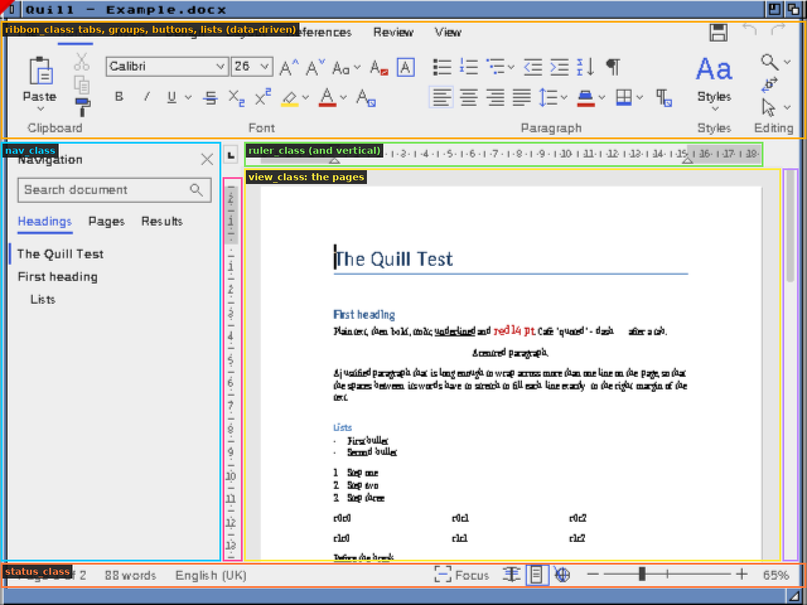

# 4. The classes

Everything the user looks at most (ribbon, tabs, panes, the document, the status bar) is a custom
MUI class drawing itself in the theme. Dialogs use MUI's own gadgets. This chapter explains MUI
briefly, shows how a class is written, then documents every class of the kit with its API and an
annotated listing, and the classes the family's programs have that the kit doesn't (yet).

## MUI in five minutes

MUI is an object-oriented toolkit built on BOOPSI, the Amiga's object system.

- **Objects** are made with `NewObject()` (or MUI's macros: `VGroup, ..., End`) and freed with
  `MUI_DisposeObject()`. Disposing a parent disposes its children, so disposing the application
  frees every window and gadget in it.
- **Attributes** (`MUIA_...`) are tags: `get(obj, attr, &v)` reads one (the kit's `cs_get(obj, attr)`
  returns it), `set(obj, attr, v)` writes one. `nnset()` writes without firing notifications: use
  it when you update a gadget to match the program, so it doesn't report the change back.
- **Methods** (`MUIM_...`) are messages: `DoMethod(obj, MUIM_Something, args...)`.
- **Notifications** connect objects without code: *when attribute A of X changes, do this to Y*.

  ```c
  /* the scroll bar moved: tell the view */
  DoMethod(vscroll, MUIM_Notify, MUIA_Prop_First, MUIV_EveryTime,
           (ULONG)view, 3, MUIM_Set, MUIA_View_Top, MUIV_TriggerValue);
  /* the ribbon chose a command: the main loop gets its number */
  DoMethod(ribbon, MUIM_Notify, MUIA_CsRibbon_Command, MUIV_EveryTime,
           (ULONG)app, 2, MUIM_Application_ReturnID, MUIV_TriggerValue);
  ```
- **Groups** lay things out: `VGroup`, `HGroup`, `ColGroup(n)`. Each child says how much room it
  needs (its min/max) and how much of the spare room it wants (`MUIA_HorizWeight`,
  `MUIA_VertWeight`; 0 means "only what I need"). `MUIA_Group_PageMode` shows one child at a time
  (tabbed panes, the File page). `MUIA_ShowMe` hides a child and gives its room to the others.
- **Custom classes** subclass `MUIC_Area`. A *dispatcher* receives every method sent to the object
  and handles the ones it cares about.

All the kit's tags are in one private range, `CS_TAG(n)` = `TAG_USER | 'CS' << 16 | n`, a block of
0x100 per class. A program's own classes take their own (Jotter's `JT_TAG`, 'JT'). Next to each
tag say what it is: **(init)** set only at creation, **(set)**, **(get)**, **(notify)** others may
watch it.

## Writing a class

Every kit class has the same shape. `cs_tabs.c` (a strip of tabs) is a complete small one; its
skeleton, annotated:

```c
typedef struct { CS_CLASS_HEAD;                     /* the event handler node, shown, has_ehn */
                 const char *const *labels; int n, active, hot; ... } TData;
static struct MUI_CustomClass *tcls;

CS_DISPATCHER(tdispatch)                            /* ULONG f(__reg("a0") IClass *cl, __reg("a2") Object *obj,
                                                       __reg("a1") Msg msg): BOOPSI's registers */
{
  TData *d;
  switch (msg->MethodID) {
  case OM_NEW:                                      /* the superclass first, then our data */
    if (!(obj = (Object *)DoSuperMethodA(cl, obj, msg))) return 0;
    d = INST_DATA(cl, obj);
    memset(d, 0, sizeof *d);
    d->labels = (const char *const *)GetTagData(MUIA_CsTabs_Labels, 0, ((struct opSet *)msg)->ops_AttrList);
    CS_EHN(d, IDCMP_MOUSEBUTTONS | IDCMP_MOUSEMOVE);   /* the mouse events we want */
    return (ULONG)obj;
  case OM_SET:                                      /* our attributes; then on to Area (break), which
                                                       sends the notifications */
    ...if (d->shown) MUI_Redraw(obj, MADF_DRAWOBJECT);
    break;
  case OM_GET:                                      /* answer ours, pass the rest on */
    ...
  case MUIM_AskMinMax: {                            /* Area adds its frame first, our room on top;
                                                       sizes from the font height */
    LONG h = cs_font()->tf_YSize + 9;
    DoSuperMethodA(cl, obj, msg);
    CS_MINMAX(msg, 40, 200, MUI_MAXMAX, h, h, h);
    return 0;
  }
  CS_CLASS_COMMON(TData);                           /* Setup (theme, handler), Cleanup, Show, Hide */
  case MUIM_Draw:                                   /* only here do we draw */
    DoSuperMethodA(cl, obj, msg);
    if (((struct MUIP_Draw *)msg)->flags & (MADF_DRAWOBJECT | MADF_DRAWUPDATE)) draw(INST_DATA(cl, obj), obj);
    return 0;
  case MUIM_HandleEvent: {                          /* the mouse */
    struct IntuiMessage *im = ((struct MUIP_HandleEvent *)msg)->imsg;
    ...
    if (im->Class == IDCMP_MOUSEMOVE) { ...hover changed: MUI_Redraw...; return 0; }   /* others want moves too */
    if (im->Class == IDCMP_MOUSEBUTTONS && im->Code == SELECTDOWN && i >= 0) {
      SetAttrs(obj, MUIA_CsTabs_Active, i, TAG_DONE);   /* through OM_SET: notifications go */
      return MUI_EventHandlerRC_Eat;                    /* ours: nobody else gets this click */
    }
    return 0;
  }
  }
  return DoSuperMethodA(cl, obj, msg);              /* everything else to Area */
}
struct MUI_CustomClass *cs_tabs_class(void)         /* made on first call */
{
  if (!tcls) tcls = MUI_CreateCustomClass(NULL, (STRPTR)MUIC_Area, NULL, sizeof(TData), (APTR)tdispatch);
  return tcls;
}
void cs_tabs_free(void) { if (tcls) { MUI_DeleteCustomClass(tcls); tcls = NULL; } }
```

`kit/amiga/cs_common.h` holds the shared pieces: `CS_CLASS_HEAD` (the event handler node and the
flags every class needs), `CS_CLASS_COMMON(T)` (the Setup, Cleanup, Show and Hide cases),
`CS_EHN`, `CS_MINMAX`, `CS_INSIDE`, `CS_DISPATCHER`. The rules behind the skeleton:

- **Pass on what you don't handle**: `return DoSuperMethodA(cl, obj, msg)`. Where Area must see a
  method too (`OM_SET`, `MUIM_Cleanup`, `MUIM_Show`), `break` instead of returning.
- **Only draw in `MUIM_Draw`.** To redraw, `MUI_Redraw(obj, MADF_DRAWOBJECT)`; never draw from an
  event directly, and **never while hidden** (a pane page not in front has no place on the window
  and would draw over something else): every class keeps `shown` from `MUIM_Show`/`MUIM_Hide`.
- **Draw inside `_mleft.._mright`, `_mtop.._mbottom`**; `_rp(obj)`, `_screen`, `_win`, `_window`,
  `_app` are valid between Setup and Cleanup.
- **Size with `MUIM_AskMinMax`**: the superclass first, then add yours, from the font height.
- **Events with an event handler node**, added in Setup and removed in Cleanup
  (`cs_theme_handler`/`cs_theme_cleanup` do both). Return `MUI_EventHandlerRC_Eat` only for events
  that are yours. A class that needs keys before others sets `ehn_Priority` (the ribbon: 1).
- **Report outward with attributes, not calls**: set a (notify) attribute and let main.c decide
  what it means; for "something happened" with no value, set it to TRUE each time
  (`MUIV_EveryTime` notifications fire on every set).
- **Take orders with methods**: `MUIM_<Class>_Refresh` (redraw from the program's state) is the
  usual one. Classes read the program's state through functions (`cs_cmd_state()`, the document
  pointer they were given) rather than keep copies that drift.
- **Timers**: an input handler node with `MUIIHNF_TIMER` (`MUIM_Application_AddInputHandler`);
  remove it in Cleanup. Easel's canvas marches its selection outline at 250 ms.
- **Later**: inside an event, `DoMethod(_app(obj), MUIM_Application_PushMethod, target, n, ...)`
  runs a method after the current input; use it when acting now would close the thing being
  clicked (a pop-up list's own choice).
- **`MUIA_FillArea, FALSE`** on a class that paints every pixel (the document view), or MUI clears
  it first and it flickers. **`MUIA_ShortHelp, " "`** on a class that gives bubbles.

---

## The kit's classes

`cs_classes.h` declares them all; `cs_classes_make()` makes them, `cs_classes_free()` frees them.

### The ribbon: `cs_ribbonmui.c`



*(Quill's ribbon, which the kit's is generalised from, labelled with its classes.)*

| | |
|---|---|
| `MUIA_CsRibbon_Def` (init) | `const CsRibbonDef *`: the tabs, Quick Access, File and Tell Me commands (`kit/shared/cs_ribbon.h`) |
| `MUIA_CsRibbon_Tab` (set, get, notify) | the tab shown |
| `MUIA_CsRibbon_Command` (notify) | a command chosen: its id, set each time |
| `MUIA_CsRibbon_Value` (get, set) | the list entry that came with it, -1 none: read it, then set it back to -1 |
| `MUIA_CsRibbon_Minimised` (set, get) | only the tab strip (double-click a tab) |
| `MUIM_CsRibbon_Refresh` | states changed: redraws what differs, lays out again if a contextual tab came or went |
| `MUIM_CsRibbon_KeyTips` | shows the KeyTips (also Alt alone, or F10, by itself) |
| `MUIM_CsRibbon_Open, id` | the item for command id shown and pressed: its tab shown, its list opened (Tell Me) |

```c
ribbon = NewObject(cs_ribbon_class()->mcc_Class, NULL, MUIA_CsRibbon_Def, (ULONG)&jotter_ribbon,
                   MUIA_ShortHelp, (ULONG)" ", TAG_DONE);
DoMethod(ribbon, MUIM_Notify, MUIA_CsRibbon_Command, MUIV_EveryTime, (ULONG)app, 2,
         MUIM_Application_ReturnID, MUIV_TriggerValue);
```

How it works, in the order of the file:

- **Layout** is the portable `cs_rb_layout()` (shared chapter 4 describes the rules), given a
  text-measuring function over the rastport and `cs_font()`'s height; boxes come back relative to
  the object, so the class adds `_mleft`/`_mtop`. It lays out again when the width or the tab
  changes, or a contextual tab comes or goes (`relayout`).
- **Drawing** (`draw_all`): the tab strip (the File tab in the accent, the current tab bold with
  its line, contextual tabs with a line over them, Quick Access icons, the Tell Me box), then each
  group's caption and dividing line, then each item (`draw_item`): a large item's 24-pixel icon
  and its label on one or two lines (`large_label`), a small item's 16-pixel icon and label, a
  check item's box, a drop-down's arrow, a collapsed group's button. Each item's state comes from
  `cs_cmd_state()` and is remembered, so `MUIM_CsRibbon_Refresh` redraws only when something differs.
- **Acting** (`press`): a button sets `MUIA_CsRibbon_Command`; a drop-down (or a split button's
  arrow) opens its list with `cs_popup()` under it, whose choice comes back as a private attribute
  (`pop_choice`) and is sent with its value; a collapsed group opens its tools as a list (their icons,
  ticks and disabled states included); a drop-down chosen from there opens its own list in turn.
  Lists open on the press, buttons act on the release over the same item.
- **KeyTips** (`kt_start`, `kt_key`, `kt_draw`): codes from the portable `cs_rb_keytips_*`, badges
  drawn under each box, typed letters matched with `cs_keytips_match`; Esc goes back a level. The
  ribbon's event handler has priority 1 so it sees keys before the document view, and eats them
  only while KeyTips are shown. Alt is noticed as a key-down and key-up of Alt with nothing between.
- **Bubbles** (`MUIM_CreateShortHelp`): the command's name, its shortcut, its help.

### The drop-down list: `cs_popup.c`

```c
void cs_popup(Object *owner, LONG x, LONG y, LONG minw, const char *const *labels, const int *icons,
              int n, int cur, ULONG attr);
```

A borderless window at screen position x, y listing labels (translated as drawn) with optional icons
(`CS_POP_OFF` and `CS_POP_TICK` ORed in mark an entry disabled or ticked; an empty label is a
separator). The entry chosen comes back as `set(owner, attr, index)`, **pushed**
(`MUIM_Application_PushMethod`) so it arrives after the list has closed: closing a window from
inside its own event isn't safe. It closes when it loses activation, and repairs the window it lay
over (`MUIM_Group_InitChange`/`ExitChange` on its root: MUI doesn't always). Keys: cursor up and
down, Return, Esc. Right to left, it opens leftwards from x.

### The flat scroll bar: `cs_scroll.c`

```c
Object *cs_scrollbar(int horiz);    /* MUIA_Prop_Entries, _Visible, _First (set, get, notify) */
```

A drop-in for a `PropObject`: the same three attributes and notifications, a 10-pixel bar with a
rounded thumb at least 13 pixels long, no arrows. A click beside the thumb moves nine tenths of a
page; dragging follows the pointer. Integer arithmetic only (`cs_muldiv`), so no FPU is needed.

### Tabs: `cs_tabs.c`

| | |
|---|---|
| `MUIA_CsTabs_Labels` (init, set) | `const char *const *`, NULL-ended, English |
| `MUIA_CsTabs_Active` (set, get, notify) | the tab chosen |
| `MUIA_CsTabs_Closable` (init) | each tab has a close box (document tabs) |
| `MUIA_CsTabs_Close` (notify) | the tab whose close box was clicked |

A pane's tabs need no code in main.c: notify `MUIA_CsTabs_Active` into a page group's
`MUIA_Group_ActivePage`. (Easel's `head_class` in `panels.c` is the same thing.)

### The status bar: `cs_status.c`

| | |
|---|---|
| `MUIA_CsStatus_Fields` (init) | `"L0 R70 R100 R130"`: each field's side (from the Left or Right) and width in pixels, 0 the rest |
| `MUIM_CsStatus_Set, field, text` | a field's text (copied; redrawn only if it changed) |
| `MUIA_CsStatus_Click` (notify) | a field was clicked: its number |

### A pane's header: `cs_pane.c`

```c
Object *cs_pane(const char *title, Object *contents, Object **header);   /* MUIA_CsPane_Close (notify) */
```

The title in bold and a close box over the contents, in a group of weight 30. Put `cs_balance()` between pane and document so the width can be dragged (MUI's own Balance
splitter; a plain line on the Zune versions that lack the class), and hide both with `MUIA_ShowMe`
when the pane is turned off.

### The File page's column: `cs_backstage.c`

| | |
|---|---|
| `MUIA_CsBackstage_Ids` (init) | `const ULONG *`, 0-ended: commands (`~0UL` a line) |
| `MUIA_CsBackstage_Pick` (notify) | the command clicked; 0 is Back |
| `MUIA_CsBackstage_Active` (set) | the command whose page is shown, lit |

A band in the accent colour with Back and each command's icon (in one pen, `cs_icon_pen`) and name
in white. The program puts it in an `HGroup` with the page of the chosen command, as page 1 of a
`MUIA_Group_PageMode` root whose page 0 is the normal window (Jotter's `make_window`).

### Tell Me: `cs_tellme.c`

```c
void cs_tellme_open(Object *ribbon);
```

A small window: "What do you want to do?", a field and a list of the commands that match
(`cs_cmd_search`, updated as the user types; cursor keys move in the list while typing goes on).
Return or a double click runs the one chosen through `MUIM_CsRibbon_Open`, which shows its tab and
opens its list where it has one.

### The back buffer: `cs_buffer.c`

```c
struct RastPort *cs_buf_begin(CsBuffer *b, Object *obj);  /* where to draw (window coordinates) */
void cs_buf_show(CsBuffer *b, Object *obj, x0, y0, x1, y1); /* that part to the window: one blit */
int  cs_buf_scroll(CsBuffer *b, Object *obj, dx, dy, struct Rectangle *boxes, int *n);
void cs_buf_clip(CsBuffer *b, const struct Rectangle *boxes, int n);
void cs_buf_free(CsBuffer *b);                             /* in Cleanup and Hide */
```

A document view's off-screen bitmap, made like the window's (`AllocBitMap` with the window's as
friend: on a graphics card, in its memory) with a layer over it (graphics.library clips only through
a layer; drawing past a bare bitmap's edge would write over memory). The layer starts at 0,0, so
window coordinates work in it unchanged. The view draws into it and shows it in one `ClipBlit`, so a
redraw never flickers through the background. `cs_buf_scroll` moves the picture with
`ScrollRaster` (the blitter, or the graphics card's) and returns the strips that came into view, for
the view to draw; it refuses (returns 0) when most of the view moved, and the caller draws it all.
Without memory for the bitmap, `cs_buf_begin` returns the window's rastport and drawing goes
straight there. Folio's page view is the full example (with background rendering of the next page).

### Dialog buttons and labels: `cs_dialog.c`

`CsButton("_Replace")` (a flat button, its key underlined and made `MUIA_ControlChar`, at least
64 pixels wide), `CsLabel(text, flags)` (MUI's label in the light theme; ours in the dark one,
where MUI's black text can't be read), `CsTitle(text)` (a bold section title). Chapter 6.

---

## The document view: Jotter's `view.c`

Every program has one class the kit can't provide: the view of its document. Jotter's is the
pattern in about 450 lines (chapter 16 goes through it): an Area subclass with `MUIA_FillArea,
FALSE`, given the document and its scroll bars at creation; it lays out rows (lines, or wrapped
pieces of lines), draws them into a `CsBuffer` with the selection and the caret, scrolls with
`cs_buf_scroll`, turns keys and clicks into calls of the core (`text_insert`, `text_move`...),
and reports `MUIA_View_Changed` so main.c refreshes the rest. It never changes the document by
itself beyond what the user typed, and it never computes what the core can.

## The family's other classes

The kit grew from these; each is the best place to start for its kind of part. Paths are relative
to each program's directory.

| Class | Where | What it does, its API |
|---|---|---|
| **Strip** (toolbar) | `folio/amiga/bars.c` | One row (or column, `MUIA_Strip_Vertical`) of items from a table `StripItem { kind, id, icon, label, help }` (`SI_ICON`, `SI_LABEL`, `SI_TEXT`, `SI_SEP`, `SI_GAP`, `SI_COLOR`); `MUIA_Strip_Pick` (notify) the id clicked; `MUIM_Strip_Refresh`. States from one `strip_state(id)` shared with the menus. The plainest toolbar: copy it for a program without a ribbon. |
| **Toolbox** | `easel/amiga/toolbox.c` | PhotoCraft's tool palette: groups of tools, a group's other tools in a pop-out list (`popup_list`), the colour swatches; one or two columns by screen height. `MUIA_Tools_Pick` (notify) the tool, `MUIA_Tools_Color` (notify) a swatch clicked, `MUIM_Tools_Refresh`. |
| **Options bar** | `easel/amiga/toolbox.c` | The current tool's settings in one row, described per tool by `fields_for()` with `SCRUB` (drag-to-change number), `CHOICE`, `CHECK`, `BUTTON` macros; `MUIM_Opts_Refresh`. Its tail may be cut at 640 pixels, so every setting is also in a menu or dialog. |
| **Colour well and picker** | `easel/amiga/colorui.c`, `colorpick.c` | The foreground and background swatches, the Color panel (sliders in HSB, RGB, Lab), the picker dialog keeping HSB, RGB, Lab and hex in step; `MUIA_Color_Changed` (notify), `MUIM_Color_Refresh`. |
| **Canvas** (picture view) | `easel/amiga/canvas.c` | Composite and view buffers, only the changed box recomposed (`MUIM_Canvas_Update`), overlays in COMPLEMENT, timers for marching ants and brush build-up, `MUIA_Canvas_*` (notify) for changes, pointer position, zoom. |
| **Page view** | `folio/amiga/view.c` | Pages rendered in steps by a timer (a click or key stops a render half way), a page cache, the back buffer and blitter scrolling, the organise mode's thumbnail grid. |
| **Text view with rulers** | `quill/amiga/view.c`, `ruler.c` | The caret, a back buffer and `ScrollRaster`; the ruler told about the caret's paragraph with `MUIM_Ruler_Set`, dragging indents and tab stops. |
| **Grid** | `ledger/amiga/grid.c`, `gridx.c` | Headings, selection, the fill handle, typing into cells (`MUIA_Grid_Editing`, `MUIA_Grid_EditText`), frozen panes, right to left (`gmirror.h`). |
| **Navigation pane** | `quill/amiga/panes.c`, `folio/amiga/panes.c` | Headings, page thumbnails, bookmarks (`nav_class`, `MUIM_Nav_Update`). |
| **Tick list** | `ledger/amiga/ticklist.c` | A themed list with tick boxes: a small complete class, a good first one to read. |
| **Sign pad** | `folio/amiga/signpad.c` | A white pad to write a signature on with the mouse, in a dialog with Clear, OK and Cancel (`signpad_dialog(title, out, cap)`); the strokes kept as text, 0-1000 across and down. |
| **Brush sheet** | `easel/amiga/brushwin.c` | Foldable sections of settings, scrub fields and lists inside one class. |
| **Splash** | `easel/amiga/splash.c` | A plain Intuition window with a progress bar while MUI isn't running yet. |
