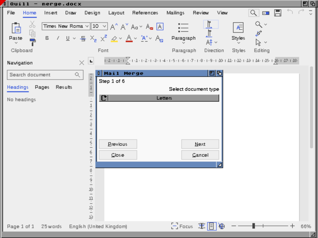

# 6. Dialogs

Shared chapter 5 has the rules (layout grid, button order, Escape and Return, fitting 480 lines,
requesters wrapped at 66). This is how the kit does them on MUI.

## The modal pattern

```c
static const ULONG ends[] = { CS_ID_OK, CS_ID_EXTRA, 0 };
Object *w = cs_dialog_window3("Replace", VGroup,                 /* title (translated), contents, */
    Child, ColGroup(2),                                          /* OK's label, an extra button */
      Child, CsLabel(tr("Find _what"), MUIO_Label_SingleFrame), Child, what = cs_string(find_what, 127),
      Child, CsLabel(tr("Replace _with"), MUIO_Label_SingleFrame), Child, with = cs_string(replace_with, 127),
    End,
    Child, cs_check("Match _case", flags & FIND_CASE, &mcase),
  End, "_Replace", "Replace _All");
if (!w) return;
set(w, MUIA_Window_ActiveObject, (ULONG)what);                   /* the field that matters, active */
id = cs_run_modal(w, ends, NULL);                                /* CS_ID_OK, CS_ID_EXTRA or CS_ID_CANCEL */
if (id == CS_ID_OK) { ...read the gadgets... }
MUI_DisposeObject(w);
```

- `cs_dialog_window()` (`cs_dialog_window3()` with a third button) builds the window on the
  program's screen (`CsWindowObject`), centred over the main window, the contents in the dialog font
  on the ribbon's colour (`CS_DLG`), and the buttons right-aligned: the extra one, the action (OK
  unless named), Cancel. The action button is the window's default object; **Esc** and the close
  gadget return `CS_ID_CANCEL`. It disposes the contents if the window can't be made.
- `cs_run_modal()` adds the window to the application, puts the main window to sleep, opens the
  dialog (logging when the window couldn't open, usually because it is taller than the screen), runs
  its own input loop until one of the `ends` ids (or Cancel) arrives, then closes it, removes it,
  wakes the main window and **redraws it** (`cs_redraw_window()`: MUI doesn't always repair what a
  closing window uncovered over custom-drawn objects). The optional `each(id)` callback sees every
  other id, and `CS_ID_IDLE` when nothing is happening: live previews hang off that, rendering when
  idle rather than on every slider movement.
- Read the gadgets after the loop, then dispose the window. Never keep dialog objects between uses.
- Inside a dialog, a string gadget's Return can end it:
  `DoMethod(str, MUIM_Notify, MUIA_String_Acknowledge, MUIV_EveryTime, app, 2, MUIM_Application_ReturnID, CS_ID_OK)`.

## Buttons and labels in the theme

- `CsButton("_Replace")`: flat, the input colour with a thin border, the accent's tint while
  pressed, the letter after `_` underlined and made its `MUIA_ControlChar` (pressing R presses it),
  in the cycle chain, at least 64 pixels wide.
- `CsLabel(text, MUIO_Label_SingleFrame)`: a label as tall as a framed gadget's text, so it shares
  its baseline. In the light theme it is MUI's own label; in the dark theme ours, because MUI draws
  labels in its text pen (black), unreadable on the dark background.
- `CsTitle(text)`: a section's title in bold.
- `cs_check(label, on, &obj)`, `cs_cycle(entries)` (translated with `tr_list`), `cs_string(text, max)`.

## Requesters

```c
int  cs_ask(const char *gadgets, const char *fmt, const char *arg);   /* MUI_Request, translated, wrapped at 66 */
int  cs_ask_string(const char *title, const char *label, char *buf, int cap);
int  cs_ask_number(const char *title, const char *label, LONG *v, LONG min, LONG max);
int  cs_file_request(int save, const char *title, char *path, int cap, const char *pattern);
```

`cs_ask` translates the gadgets and the format, fills the format in, wraps the text at 66 characters
and passes it to `MUI_Request` as a plain `%s` (a `%` in a file name can't upset it). The return
value is MUI's: 1 for the first button, 2 for the second..., 0 for the last. File requesters are
ASL's (`MUI_AllocAslRequestTags`), starting in the path's drawer with its name, on the program's
screen, with a pattern.

## Zune fallbacks

AROS's Zune, the MUI the emulator runs, lacks some of MUI 3.8's classes in some versions. Found in
Quill's emulator check:

- **No Radio class**: six of Quill's Mailings windows never opened. `cs_radio(entries)` makes MUI's
  radio buttons, or a cycle gadget where the Radio class can't be made; read and set either with
  `CS_RADIO_ACTIVE` (it is `MUIA_Cycle_Active` or `MUIA_Radio_Active`, decided at the first call).

  

  *Quill's Mail Merge Wizard on Zune, its choices as cycle gadgets.*
- **No Balance class** (found with Jotter: its window couldn't be made, the log showed the Balance
  object was NULL): `cs_balance()` makes MUI's splitter, or a thin line that can't be dragged.
- **No Scrollgroup or Virtgroup**: a dialog that relied on scrolling (Quill's Match Fields, 29 rows)
  must fit without it: two pairs to a row, or pages.
- **Frame titles** are drawn faint (white on the frame) by Zune: a Zune look; check on MUI 3.8.
- **Hooks** may be called with a misaligned stack (chapter 1).

When a dialog's window doesn't open, `cs_run_modal` logs it (`DEBUG=`): the first thing to look for.
