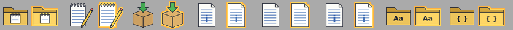

# 13. Workbench icons

The icons a user sees on the Workbench (the program's drawer, the program, its documents, the
installer, the README) are drawn by `kit/amiga/tools/mkicons.py` from a small spec the program keeps
(Jotter's `example/tools/wbicons.py`):

```python
ICONS = [
    {'file': 'Jotter.info', 'kind': 'drawer', 'picture': 'drawer', 'window': (40, 30, 420, 200)},
    {'file': 'Jotter/Jotter.info', 'kind': 'tool', 'picture': tool, 'stack': 32768, 'pos': (16, 8),
     'tooltypes': ('(PUBSCREEN=Workbench)', '(LANGUAGE=de)', '(DEBUG=RAM:Jotter.log)')},
    {'file': 'Jotter/Install-Jotter.info', 'kind': 'project', 'picture': 'install', 'deftool': 'Installer',
     'tooltypes': ('APPNAME=Jotter', 'MINUSER=NOVICE', 'DEFUSER=AVERAGE'), 'stack': 16384, 'pos': (96, 8)},
    ...
]
```

```sh
python3 kit/amiga/tools/mkicons.py <package-dir> tools/wbicons.py preview.png
```



*Jotter's icons, each with its selected image: the drawer (with the pad as its emblem), the
program, the installer, the README, the example document, the licence, the Fonts and Source drawers.*

## What is written

Each `.info` is a `DiskObject` (magic 0xE310) as icon.library's `PutDiskObject` writes it: the
gadget, the kind (disk, drawer, tool, project), the default tool and tool types, the stack, the
position in its drawer's window, and for drawers an `OldDrawerData` with the window's size. It holds
two pictures of the same drawing:

- the **classic planar image** for Workbench 2.x to 3.1: 46 x 46, two bitplanes in the standard
  four colours (grey, black, white, blue), with its selected image;
- a **GlowIcon** (the OS 3.5 colour icon, also read by AROS and MorphOS): an IFF `FORM ICON` with a
  `FACE` chunk (size, flags) and an `IMAG` chunk per state, each run-length packed over a palette of
  up to 256 colours, transparent colour 0.

Pictures are drawn with PIL at four times the size and scaled down, then every pixel made fully
opaque (blended with Workbench grey) or transparent. The selected image is the picture brightened
with a warm glow round it. `read_info()` reads one back (the tests check the magic, kind, default
tool, tool types and the GlowIcon). NewIcons (pictures kept in tool types) are not made.

## Pictures

Built in: `drawer` (a folder with the program's emblem, from the spec's `emblem(d)`), `fonts` and
`source` (drawers marked Aa and { }), `document` (a page with lines), `readme` (a page with an i),
`install` (a box with an arrow into it). A program draws its own with the helpers (`page`, `S()` for
46-unit coordinates, `INK`, `PAPER`...); Easel's easel and framed pictures, Quill's quill, Ledger's
sheet and Folio's pages are the family's.

## Rules

- **Original pictures**: no copied logos, no Workbench or MagicWB icons traced.
- **Recognisable in four colours**: look at the planar image too (the preview shows the GlowIcon).
- **Commented-out tool types** in brackets (`(PUBSCREEN=Workbench)`) show what can be set.
- **Positions** so the drawer opens tidy: the program and installer along the top, documents below,
  drawers last.
- A program that saves documents may write an icon beside each file it saves, only when there is
  none and only if the preference is on (Easel writes a thumbnail of the picture).
