# Jotter in the emulator

Jotter was run in FS-UAE on 18 November 2026: an A4000 with a 68040, a uaegfx card, 64 MB, the AROS
ROM and its Zune as MUI, a 640 x 480 Workbench screen. The script was
[`example/tools/emucheck.sh`](../../../example/tools/emucheck.sh) (chapter 12), with KeyTips, the File
page, Tell Me and typing driven by keys and the dialogs opened with `CMD=`. **Not yet checked on
real AmigaOS 3.x with MUI 3.8.**

## What the first runs found

The first run's window never opened: Jotter said "Jotter couldn't make its window" and nothing
more. With every part's pointer logged (`DEBUG=`), the second run showed the culprit at once:

```
window: view 0x7878634, scroll bars 0x78780bc 0x787826c, outline 0x7879f74, pane 0x787a414, balance 0, ...
window: no Balance class (Zune?): a line instead          (after the fix)
```

This Zune has no Balance class, and one missing child makes MUI refuse the whole window. The kit now
has `cs_balance()` (MUI's splitter, or a plain line), and Jotter logs its window's parts.

The third run showed every window, and one more thing: **Esc quit Jotter**. The log of every id the
main loop received told why:

```
input 904        the window's "esc" input event (ID_BACKSTAGE: Esc closes the File page)
input 108        ID_QUIT: a close request, sent by Zune for the same Esc
```

Jotter now takes a close request that follows an Esc as part of the Esc. Dialogs saw the same pair
(their Cancel twice, the second arriving after the dialog had gone): the main loop ignores ids below
100. And a class that reports with an attribute must answer `OM_GET` for it too: the File page's
column and the status bar didn't, so every File page choice read as Back (0); both do now.

Also seen, and expected on Zune: the Direction radio buttons of Replace are a cycle gadget
(`cs_radio`'s fallback, logged as "no Radio class"), and Zune's frame titles don't show.

## The screenshots

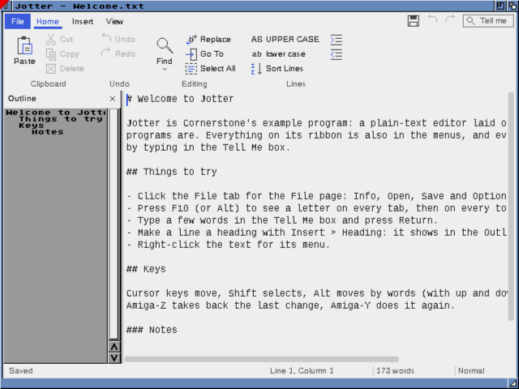

*Jotter with Welcome.txt: the ribbon's Home tab (Paste large; Cut, Copy and Delete, Undo and Redo
dimmed as nothing is selected or done yet; Find as a split button; Lines with two icon-only
items), the Quick Access buttons and the Tell Me box, the Outline pane listing the headings, the
text in QuillMono, the status bar.*

| | |
|---|---|
| 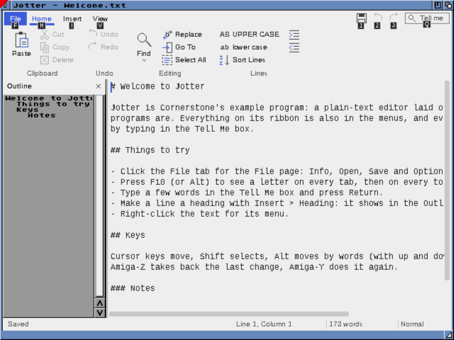 | 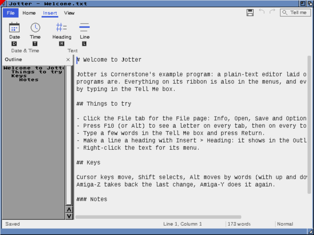 |
| F10: KeyTips on the File tab, the tabs, the Quick Access buttons (1 2 3) and the Tell Me box (Q). | I: the Insert tab, a letter on each of its tools. |
| 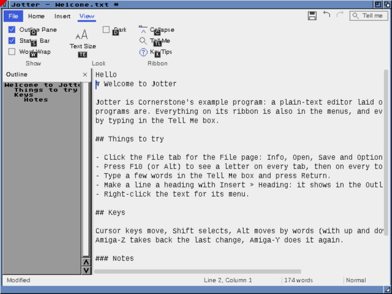 | 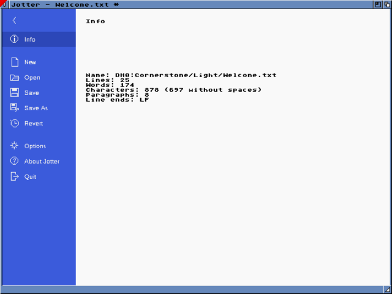 |
| The View tab's KeyTips: two-letter codes where names share a first letter. Outline Pane and Status Bar ticked. | F: the File page, the column in the accent colour with Info chosen. |
| 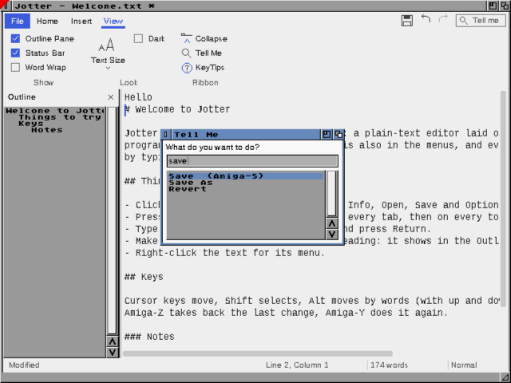 | 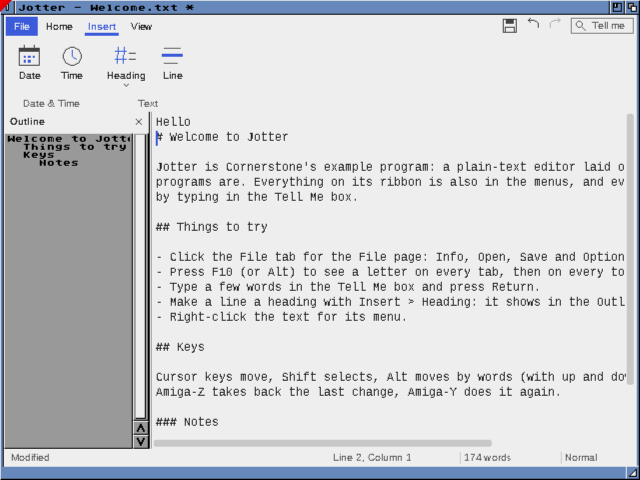 |
| Q: Tell Me, "save" typed: Save (with its shortcut), Save As, Revert (its help says "saved"). | "Hello" and Return typed: the title has its *, Undo is enabled, the status bar says Modified. |
| 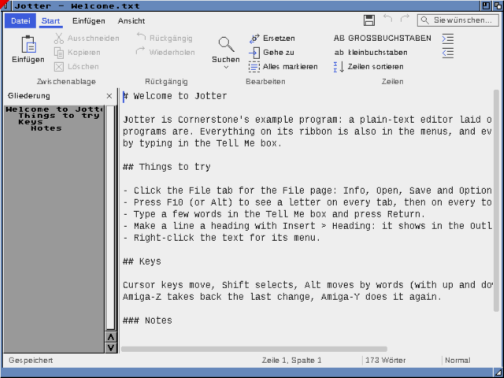 | 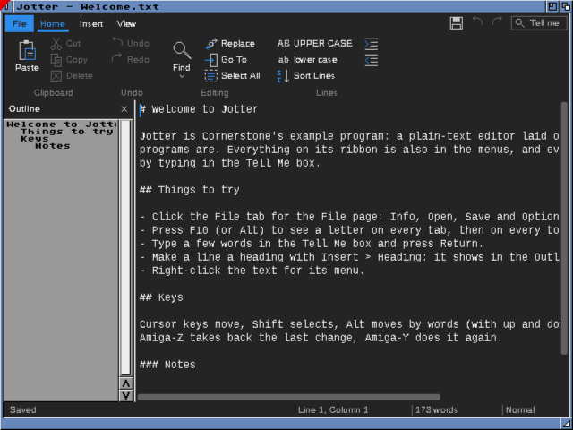 |
| German (`language=de`): Datei, Start, Einfügen, Ansicht; Sie wünschen... in the Tell Me box. | The dark theme: every token's dark value; MUI's own list (the outline) keeps MUI's colours. |
| 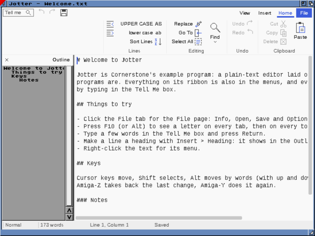 | 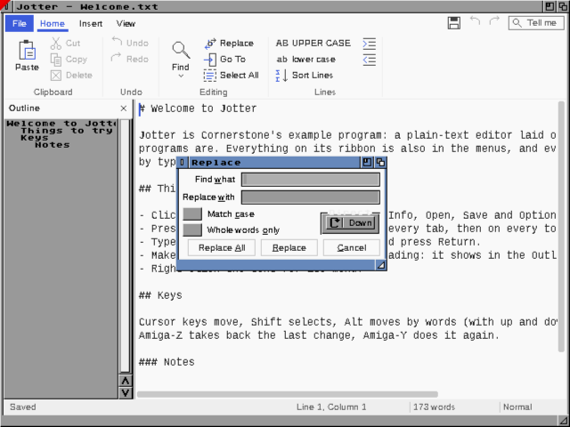 |
| Right to left (`rtl=1`, a test switch): the ribbon, its icons, the status bar and the pane's header mirrored. MUI's groups are not: the pane stays on the left. | Replace (`CMD=210`): the grid of labels, the check boxes, the direction as a cycle gadget (Zune), Replace All, Replace, Cancel. |
| 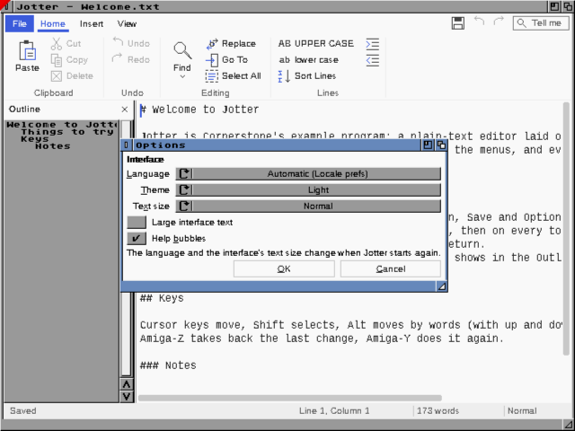 | 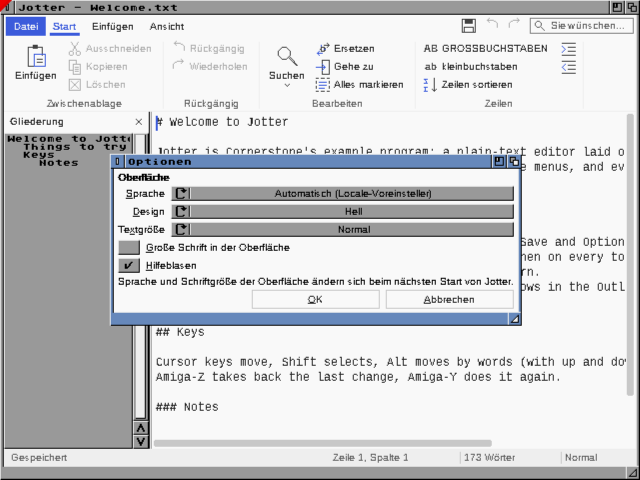 |
| Options (`CMD=106`). | Options in German. |

## Still to check

- On AmigaOS 3.x with MUI 3.8 (Balance and Radio there; frame titles; MUI's own requesters).
- At 640 x 512 and on a larger RTG screen; on a 256-colour screen.
- The context menu (right-clicks are unreliable in this emulator setup), the pop-up lists by mouse,
  the collapsing of groups at a narrower window, dragging the scroll bars, the clipboard with another
  program, Open and Save through ASL.
- Speed on a real 68040 with a long document (rows are rebuilt in full after each change).
