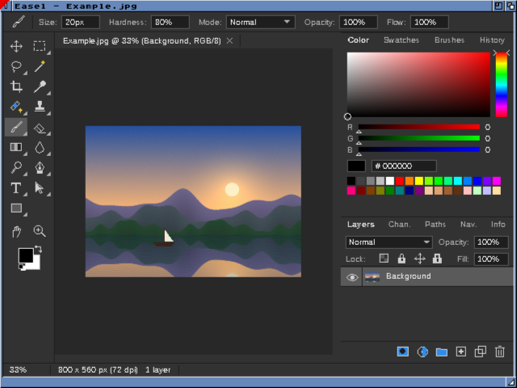
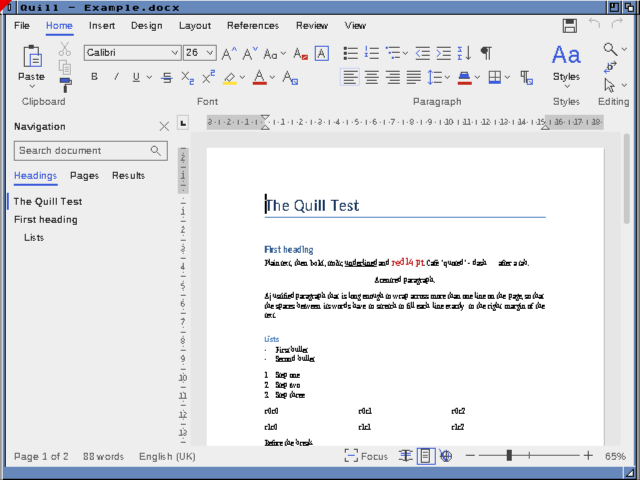
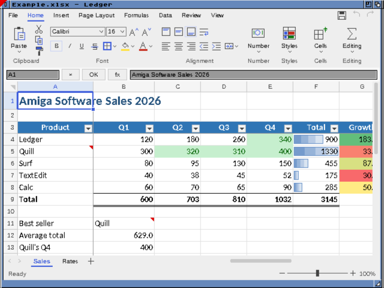
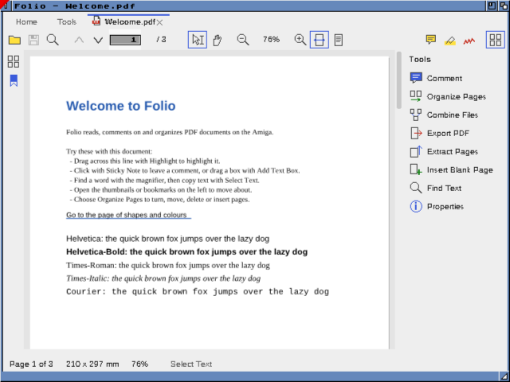
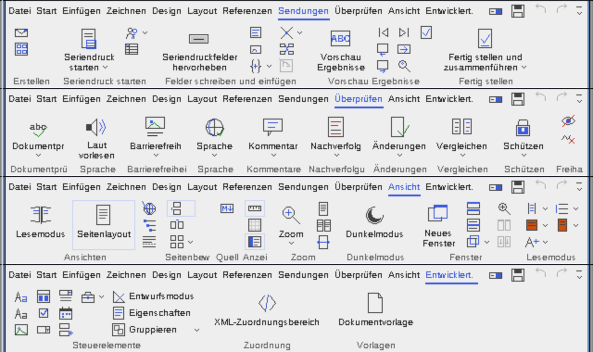
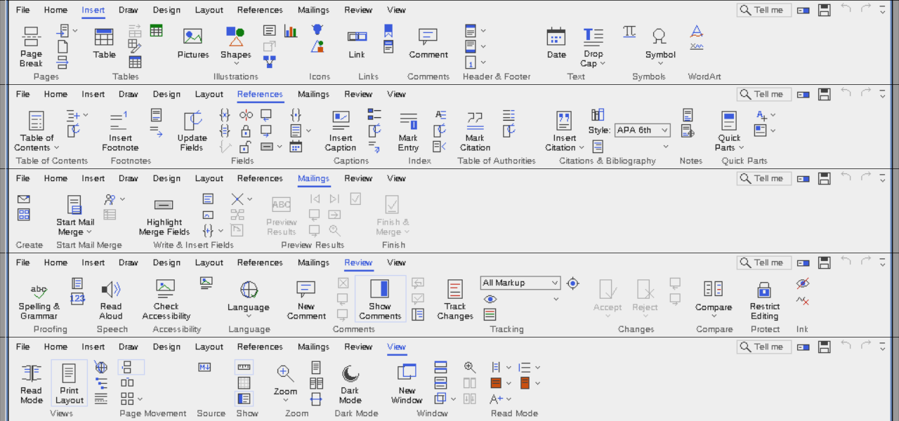

# 4. The main window

One window per document, filling the screen below the title or menu bar, as the upstream PC
programs fill theirs. Panes live inside it; floating windows are for things the user opens on
purpose (a palette, a dialog). From the top:

```
+--------------------------------------------------------------------------------------------+
| [File] Home  Insert  View                                     [S][U][R]  [ Tell me      ] |  tab strip      fh+10
|  +-------+ [x] Cut       | [<] Undo | +-----+ [ab] Replace  | AB UPPER   [>]              |
|  | Paste | [=] Copy      | [>] Redo | |Find | [->] Go To    | ab lower   [<]              |  groups: 3 rows  3(fh+7)+4
|  |       | [X] Delete    |          | | v   | [::] Select All| AZ Sort                     |
|  Clipboard               |  Undo    |      Editing          |    Lines                    |  captions       fh+3
+--------------+-+---------------------------------------------------------------------+---+
| Outline   [x]| |  # Welcome to Jotter                                                 | # |
|  Welcome     | |                                                                      | # |  pane header    fh+10
|   Things to  |:|  Jotter is Cornerstone's example program: a plain-text editor ...     |   |
|   Keys       |:|                                                                      |   |  scroll bars    10 px
|    Notes     | |                                                                      |   |
+--------------+-+---------------------------------------------------------------------+---+
| Modified                                           | Normal | 166 words | Line 1, Col 1    |  status bar     fh+6
+--------------------------------------------------------------------------------------------+
```

Four quite different programs are built this way. Each screenshot is the program's main window on
a 640 x 480 screen in the emulator:

| | |
|---|---|
| **Easel** (after PhotoCraft): dark theme, toolbox, options bar, tabbed panels. | **Quill** (after WordCraft): ribbon, navigation pane, rulers. |
|  |  |
| **Ledger** (after GridCraft): Quill's ribbon with other items, a grid. | **Folio** (after PDFCraft): tabs, tool strips, a tools pane. |
|  |  |

The labelled versions (`../img/*-classes.png`) name the class that draws each part; they are
explained in [the Amiga classes chapter](../platforms/amiga/04-classes.md).

## Sizes

Everything is measured from **fh**, the interface font's line height (chapter 1). The Amiga's
QuillSans 11 has fh = 11; its large-text setting, 15.

| Part | Size | At fh = 11 |
|---|---|---|
| Ribbon tab strip | fh + 10 | 21 |
| Small ribbon item (16-pixel icon and label) | fh + 7 high; 16 + 6 + label + 8 wide (+9 for an arrow) | 18 high |
| Large ribbon item (24-pixel icon over its label, one or two lines) | three rows high; label + 10 wide, at least 40 | 54 high |
| Icon-only item | 22 wide (+9 for an arrow) | 22 |
| Groups' body | 3 rows + 4 | 58 |
| Group caption | fh + 3 | 14 |
| **Whole ribbon** | **5 fh + 42** (minimised: fh + 12) | **97** (23) |
| Quick Access button | 22 x tab strip | 22 x 21 |
| Tell Me box | 22, or 22 + its words + 8 when there is room | |
| A one-row toolbar (Folio's strips) | fh + 12 | 23 |
| Pane header | fh + 10 | 21 |
| Tab strip in a pane | fh + 9 | 20 |
| Flat scroll bar | 10 across | 10 |
| Status bar | fh + 6 | 17 |
| File page command column | its longest label + 52, at least 120 | about 140 |
| Pop-up list row | fh + 5 | 16 |
| Dialog button | label + 24 wide, at least 64; fh + 8 high | 19 high |

At 640 x 480 with Workbench's title bar, a window with ribbon, status bar and scroll bar leaves
about 340 lines for the document: twenty-odd lines of text. Panes take a third of the width at
most, and the user can drag them narrower (or hide them: every pane is a toggle in View).

## The ribbon

The ribbon is data (`kit/shared/cs_ribbon.h`): tabs of groups of items, each item naming a
command (chapter 3).

- **Tab strip.** The File tab first, filled with the accent colour, which opens the File page
  rather than a tab of tools. Then the tabs, the current one in the accent colour and bold with a
  line under it. Contextual tabs (Table Design while the caret is in a table) show only while
  their command's state is checked, marked by a line over them. At the strip's right end the Quick
  Access buttons (icons only) and the Tell Me box.
- **Groups.** Items in columns: a large item takes a column, small ones go three to a column; a
  group is at least as wide as its caption; a thin line between groups.
- **Item kinds.** A button runs its command; a drop-down opens its list (the entry chosen is the
  command's value); a split button runs its command from its icon and label and opens its list
  from its arrow; a check item shows a tick box instead of an icon; a label is a caption.
- **Hover** fills the item with the hover colour, **pressed** with the pressed colour, **on**
  (a ticked toggle) with the checked colour and an accent outline. **Disabled** items have their
  icon in one grey and their label in the disabled colour.
- **Bubbles** name the item, its shortcut and its help, after the pointer rests on it.
- **Double-click a tab** to minimise the ribbon to its tab strip (View > Collapse the Ribbon does
  the same); clicking a tab then shows it again.

### When it doesn't fit

The layout (`cs_rb_layout`) does, in order, what the upstream programs do:

1. The tab names keep 16 pixels round them, then down to 6; if they still don't fit, the
   longest are cut to a common width and end in "...". Quick Access buttons drop from the end, and
   the Tell Me box loses its words before that.
2. The tab's groups at their natural widths. Too wide: **squeezed**: small items lose their
   labels (icons alone; their names stay in the bubbles), large labels go on two lines.
3. Still too wide: **groups collapse from the right**, each to one large button with its first
   tool's icon, its name and an arrow, which opens the group's tools as a list.
4. Still too wide (many groups with long names): the widest groups are narrowed to one width,
   their names cut.
5. With room left over after squeezing, groups narrower than their caption are widened, from the
   left, so captions show whole.

Every tab must fit 618 pixels (a 640-pixel window's inside) in every language: the
fit check (`kit/amiga/tools/ribbonfit.py`) lays every tab out with the real font and fails the
tests if one doesn't. Quill's ribbon fits with about 500 commands on its tabs:



*Quill in German at 640 pixels: four of its tabs, stacked. Groups at the right end collapse to
buttons ("Freiha..." is cut); large labels go on two lines.*



*The same ribbon on a 1024 x 768 screen: nothing collapses.*

## Toolbars, options bar, toolbox

Not every program wants a ribbon. Folio has one-row **strips** of icons (its main toolbar, the
comment and organise toolbars, a vertical strip on the left), each a table of items exactly as a
ribbon group is. Easel has PhotoCraft's **options bar** (the current tool's settings in one row:
drag-to-change number fields, choices, check boxes, buttons, described by a table) and a
**toolbox** (tools in groups, each group's other tools in a pop-out list; two columns on a short
screen). The rules don't change: every item is a command from the table, every setting is also
reachable from a menu or dialog (an options bar's tail may be cut off at 640 pixels).

## Panes

Panes sit beside the document: a navigation pane on the left (headings, thumbnails, bookmarks),
a tools or properties pane on the right. Each has a header with its title in bold and a close box;
several panes share a place through a tab strip over a page group (Easel's Layers, Channels,
Paths). A splitter between pane and document lets the user drag the width. Every pane is a toggle
in the View menu and tab, remembered in the preferences. On a short screen the less-used panes go
behind tabs; Tab (as in PhotoCraft) hides and shows all panels to give the document the window.

## The document view

The view paints every pixel itself, from an off-screen buffer, and scrolls with the blitter (or
the platform's equivalent), drawing only what comes into view; it never computes the document's
layout itself but asks the core. Scroll bars are thin and flat. Overlays (rubber bands, the caret,
a crop box) are drawn so that drawing them again removes them.

## The status bar

Fields of text along the window's foot: a message or the document's state on the left, figures on
the right (the page or line, a count, the zoom or text size, the language). A field is also a
button where that makes sense: click the zoom for the zoom dialog, the count for the document's
information, the line for Go To.

## The File page

The File tab doesn't show tools: it covers the whole window with the File page (the upstream
programs' "backstage"). A band in the accent colour down the left holds a Back arrow and the File
commands with their icons in white (Info, New, Open, Save, Save As, Export, Options, About, Quit);
the rest of the window shows the page of the command chosen (Info: the document's name, size and
counts; Open: recent files). Commands that open a requester close the page and run. Back, Esc or
the File tab again return to the document.

## Help bubbles

Every button, field and tool explains itself when the pointer rests on it, in one format: **its
name in bold** (with its shortcut), then one or two plain sentences wrapped at 46 characters. The
text is the command's help from the table. Bubbles can be turned off in Options.
