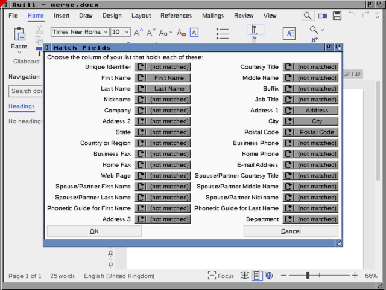

# 5. Dialogs and requesters

Dialogs use the platform's own gadgets (fields, sliders, cycle or pop-up menus, check boxes,
lists), with the family's buttons and labels where the platform lets us draw them, so they match
the main window in both themes.

## Layout

```
+-- Replace ------------------------------------------+
|   Find what [cat_____________________________]      |   labels right-aligned, gadgets left-aligned:
| Replace with [dog_____________________________]      |   a two-column grid
|                                                      |
| [x] Match case                    +- Direction --+   |   check boxes: box, then label
| [ ] Whole words only              | (o) Down     |   |   choices of two to five: radio buttons
|                                   | ( ) Up       |   |
|                                   +--------------+   |
|                   [ Replace All ] [ Replace ] [Cancel]  |   buttons bottom right; the extra one first
+------------------------------------------------------+
```

- **A two-column grid**: labels on the left, right-aligned, each with its keyboard letter
  underlined; the gadgets on the right. The gadget that matters most comes first and is active
  when the dialog opens (the cursor in its field).
- **Units after the field** ("px", "%", "cm"), not in the label.
- **Sections** have a bold title or a framed group; at most two levels.
- **Buttons at the bottom right**: the affirmative button names the action ("Replace", "Save",
  "Find Next"), not "OK" where a verb fits; then Cancel. A third button (Replace All, Reset,
  Apply) goes left of them. The order follows the platform: the family's Amiga programs put the
  action first and Cancel last (MUI's own requesters do the same); Apple's guidelines put Cancel
  to the left of the default button (see the classic Mac chapter).
- **Every button has a keyboard letter** ("_Replace": R presses it), unique in the dialog; the
  checker (`langcheck.py`) makes sure translations keep a letter marked.
- **Return** presses the default (action) button, from a text field too; **Esc** (Command-period
  on the Mac) and the window's close gadget are Cancel.
- **Nothing taller than the smallest screen**: 480 lines less the title bar on the Amiga (and
  342 on a compact Mac for anything a small tool opens). Split a long dialog into pages (a
  register group or tabs), or put long lists two to a row (Quill's Match Fields went from 29 rows
  in a scrolling group to two pairs a row when Zune turned out not to have scrolling groups).
- **Live previews** apply the change to the document as sliders move, as one undo step that the
  next preview replaces; Cancel takes it back, OK keeps it. Note the change and render when the
  user stops (on idle), so dragging a slider doesn't queue a dozen slow renders.
- **Dialogs are modal** in the family (the main window sleeps while one is open), except tool
  windows the user opens on purpose. Read the values after the dialog ends; never keep a dialog's
  objects between uses.



*Quill's Match Fields at 640 x 480: 29 rows, two pairs to a row, so it fits without scrolling.*

## Requesters

A requester asks one question or says one thing:

```c
int cs_ask(const char *gadgets, const char *fmt, const char *arg);   /* "_Save|_Don't Save|_Cancel" */
```

- **The text is wrapped at 66 characters** before it is shown (requesters don't wrap themselves on
  every platform, and a long line makes the requester as wide as the screen).
- **The buttons name the choices** ("Save", "Don't Save", "Cancel"), never "Yes" and "No"; the
  last is the one that does nothing.
- **One question** per requester, with the reason first: "The document has changes that aren't
  saved. Save them first?"
- **Small value requesters** for one line of text or a number (`cs_ask_string`,
  `cs_ask_number`): a label, the field, OK and Cancel.

## File requesters

The platform's own (ASL on the Amiga, Standard File on the Mac), starting in the drawer of the
current document with its name, with the pattern for the formats the command reads or writes.

## Messages

What goes wrong is said in the user's terms, with the reason and what to do (chapter 6):
"There isn't enough memory for Image Size. It needs 12 MB; the largest free block is 6 MB."
Never a code or an internal name alone; the debug log gets the details.
