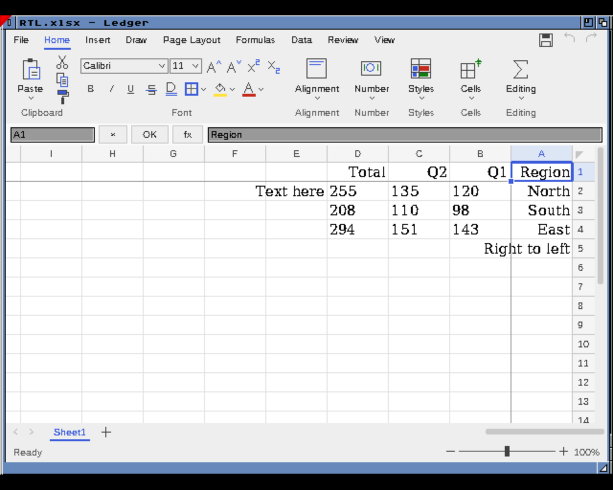
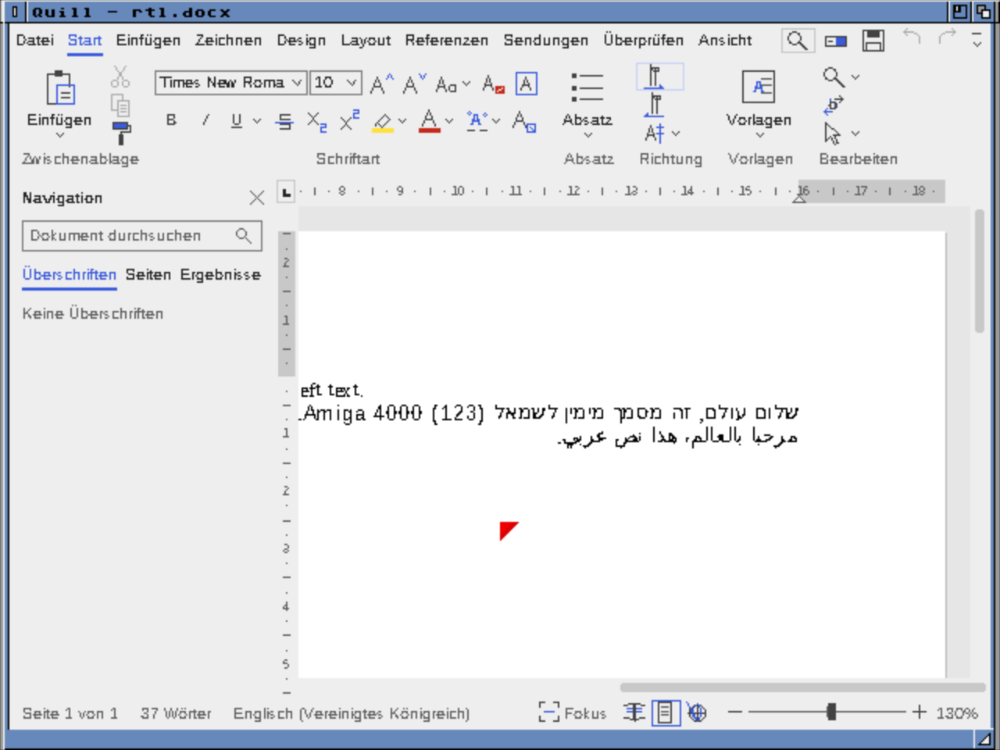

# 9. Right to left

None of the five interface languages runs right to left, but documents do: Quill lays out Hebrew
and Arabic paragraphs (with shaping) and Ledger shows right-to-left sheets. And an interface may
later be translated into Hebrew or Arabic. The family's approach is the same for both:

**Lay out in logical coordinates, as if everything ran left to right, and mirror at the last
moment.** The layout code stays simple and tested; one switch turns the picture round.

## The interface

The kit has one switch, `cs_rtl` (Amiga: in `cs_theme.h`). With it on:

- the ribbon's layout (`cs_rb_layout(..., rtl, ...)`) mirrors every box: the File tab at the right,
  groups from the right, a small item's icon right of its label, a split button's arrow on its
  left; hit testing works on the mirrored boxes;
- **directional icons** are mirrored: an icon string that starts with `>` (Back, Undo, Redo, Indent,
  Outdent, Go To, the Pane icon...) is drawn with every x turned round (`x -> 15 - x`); others
  (a magnifier, scissors, letters) are not, as text in them must still read;
- tab strips run from the right, the status bar's "left" fields start at the right, a pane's close
  box goes to its left end, pop-up lists open leftwards from their button;
- text itself is drawn as it is: a string's letters are in reading order and the system draws
  them; only where it starts is mirrored.

Jotter has a test switch (`rtl=1` in `Jotter.prefs`) that turns the interface round, so the
mirroring can be checked in the emulator before any right-to-left translation exists.

## Documents

Ledger's grid shows the technique for a document view (`ledger/core/gridgeo.c`,
`ledger/amiga/gmirror.h`): the grid is laid out and drawn in logical pixels, and a header
included after every other one replaces graphics.library's drawing calls (`Move`, `Draw`,
`RectFill`, `Text`...) in the files that draw on it with versions that mirror each x while the
sheet is right to left. Text is placed mirrored but reads left to right as it should.

*Ledger with a right-to-left sheet: column A at the right, row numbers on the right, text aligned
to the right; the ribbon stays left to right because the interface is English.*

Quill's paragraphs use the Unicode bidirectional algorithm (`quill/core/bidi.c`, tables made by
`tools/mkbidi.py`) to order runs within a line, and Arabic shaping for joined forms:

## Rules

- Never compute a position as "left + something" in drawing code that may be mirrored; get boxes
  from a layout function that knows the direction.
- Keep mirroring in one place (a layout's last step, or a drawing header), not spread through
  `if (rtl)` in every function.
- Test both directions natively (the kit's tests lay the ribbon out both ways and check the boxes)
  and look at both in the emulator.
