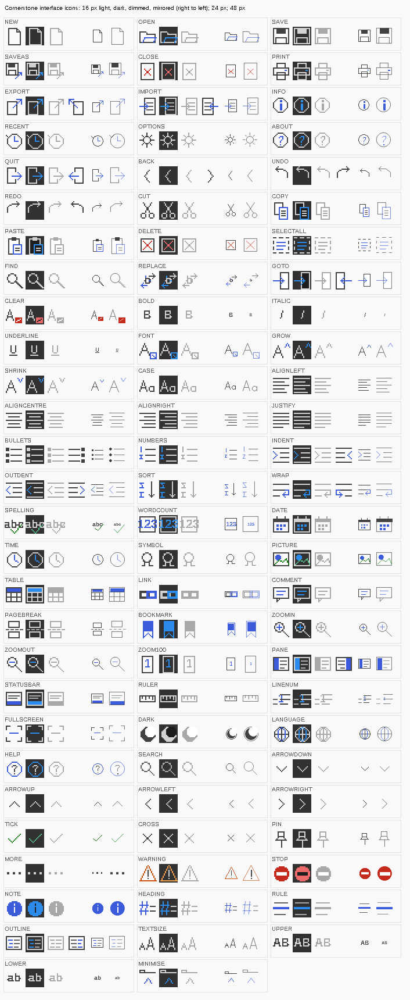

# 12. The icon language

No interface icon in the family is a bitmap. Each is a short string of drawing commands on a
**16 x 16 grid**, drawn at any size, in the theme's colours, light or dark, normal or dimmed,
mirrored for right-to-left layouts. A new icon is one line of text; the icons stay ours (drawn
from the plain object, never traced from a product); they scale with large text; and the same
strings generate every platform's icons (the Amiga's renderer draws them live; the classic Mac's
`ICN#`/`icl8`/`ics#` resources are rendered from them by a tool, see the classic Mac chapter).

This chapter is the specification. The interpreter is `kit/shared/cs_iconset.c` (`cs_icon_run`,
portable C with the drawing done through callbacks); the Amiga renderer is `cs_icon()` in
`kit/amiga/cs_theme.c`; the previewer is `kit/shared/tools/iconsheet.py`.



*`docs/img/icon-sheet.png`, made by `python3 kit/shared/tools/iconsheet.py docs/img/icon-sheet.png
--root example`: each icon at 16 pixels in the light theme, the dark theme and dimmed, mirrored
when it is directional, and at 24 and 48 pixels.*

## The grid

- Coordinates are **grid units 0 to 15**, x left to right, y top to bottom. Keep to **1..14**:
  a one-unit margin so icons don't touch their neighbours (the checker accepts 0..15).
- At size s a unit is s/16 pixels: the renderer multiplies by `size / 16` (integer arithmetic).
  At 16 pixels one unit is one pixel; at 24, one and a half (rounded down); at 48, three.
- Lines are one pixel wide at every size; **filled boxes grow** by `size/16 - 1` pixels to the
  right and down at sizes above 16, so solid parts keep their weight.

## The commands

Commands are single letters followed by numbers, separated by spaces.

| Command | Meaning |
|---|---|
| `cX` | the colour (ink) for what follows; X is one letter, below |
| `L x0 y0 x1 y1` | a line |
| `R x0 y0 x1 y1` | a rectangle's outline (corners inclusive) |
| `F x0 y0 x1 y1` | a filled rectangle (corners inclusive) |
| `O cx cy r` | a circle's outline |
| `E cx cy r` | a filled circle (spans of `dx` where `(dx+1)² + dy² <= r² + r`, so small discs are round) |
| `P n x0 y0 ... ` | a polyline through n points (n up to 32); repeat the first point to close it |
| `B text`, `I text`, `U text` | up to seven letters in the bold, italic or underlined interface font, centred in the square (letters don't scale: they are the interface font's, as button labels are) |
| `>` | as the **first character only**: a directional icon, mirrored (x becomes 15 - x) when the layout runs right to left |

The string starts in the icon ink (`ci`), as if it began with `ci`.

## The inks

Inks are colour tokens, not RGB values; the theme decides what each is in light and dark.

| Letter | Ink | Amiga theme token | Use |
|---|---|---|---|
| `i` | icon | `CS_T_ICON` | the outline: almost everything |
| `a` | accent | `CS_T_ACCENT` | the one part that matters (the arrow, the page being acted on) |
| `r` | red | `CS_T_RED` | delete, stop, record, a font colour bar |
| `g` | green | `CS_T_GREEN` | go, accept, a tick, landscape |
| `o` | orange | `CS_T_ORANGE` | warning |
| `y` | yellow | `CS_T_YELLOW` | highlight |
| `d` | dim | `CS_T_DIM` | secondary lines (text on a page, dashes) |
| `w` | white | `CS_T_WHITE` | paper: fills that make a shape opaque over what is behind it |
| `l` | light | `CS_T_BORDER2` | light grey details |
| `t` | text | `CS_T_TEXT` | where it must match the text colour |
| `s` | selection | `CS_T_SELECTION` | a selection's tint |

**Dimmed** (a disabled tool) turns every ink but white into the disabled grey, so a dimmed icon
is one grey shape on its paper. **One-pen** drawing (`cs_icon_pen`: white on the File page's
accent band) draws every ink in that pen, and white parts in the accent so they stay visible.

## How an icon is composed

Draw **back to front**: the outline in ink, then the paper filled white inside it, then whatever
lies on top, then the details. COPY shows the pattern:

```
ci R 2 1 9 11      the back sheet's outline, in ink
cw F 3 2 8 10      its paper, white, so it is opaque
ca R 6 5 13 15     the front sheet, in the accent (the copy)
cw F 7 6 12 14     its paper
ci L 8 8 11 8 L 8 10 11 10 L 8 12 11 12      three lines of text on it, in ink
```

Every icon of the shared set and of Jotter, with what it pictures:

| Icon | String | What it pictures |
|---|---|---|
| **file** | | |
| NEW | `ci P 5 3 1 10 1 13 4 13 15 3 15 L 3 15 3 1 L 10 1 10 4 L 10 4 13 4` | a page, corner folded |
| OPEN | `ci P 4 1 13 1 4 6 4 7 6 L 7 6 14 6 L 14 6 14 13 L 14 13 1 13 ca P 4 3 13 5 9 15 9 13 13` | a folder, opening |
| SAVE | `ci R 1 1 14 14 F 4 1 11 5 R 3 9 12 14` | a disk: shutter and label |
| SAVEAS | `ci R 1 1 11 11 F 3 1 8 4 R 3 7 9 11 ca L 9 14 14 9 L 12 9 14 9 L 14 9 14 11` | a smaller disk and a pen-stroke arrow |
| CLOSE | `ci R 2 1 13 15 cr L 5 6 10 11 L 10 6 5 11` | a page crossed out |
| PRINT | `ci R 4 1 11 5 R 1 5 14 11 R 4 9 11 15 ca F 11 7 12 7` | a printer with paper |
| EXPORT | `>ci R 2 4 10 15 ca L 7 9 14 2 L 10 2 14 2 L 14 2 14 6` | an arrow leaving a page |
| IMPORT | `>ci R 5 1 14 15 cd L 7 5 12 5 L 7 8 12 8 L 7 11 12 11 ca L 1 8 8 8 L 5 5 8 8 L 5 11 8 8` | an arrow into a page |
| INFO | `ci O 7 7 6 ca F 7 6 8 11 F 7 3 8 4` | i in a ring |
| RECENT | `ci O 8 8 6 ca L 8 8 8 4 L 8 8 11 8 ci L 1 3 3 5 L 3 5 5 3` | a clock with a turn arrow |
| OPTIONS | `ci O 7 7 3 L 7 1 7 3 L 7 11 7 13 L 1 7 3 7 L 11 7 13 7 L 3 3 4 4 L 10 10 11 11 L 3 11 4 10 L 10 4 11 3` | a cog |
| ABOUT | `ci O 7 7 6 ca L 6 5 7 4 L 7 4 9 4 L 9 4 9 6 L 9 6 7 8 L 7 8 7 9 F 7 11 7 11` | ? in a ring |
| QUIT | `>ci P 4 9 4 9 1 2 1 2 14 P 3 2 14 9 14 9 11 ca L 6 8 14 8 L 11 5 14 8 L 11 11 14 8` | a door and an arrow out |
| BACK | `>ci L 9 3 5 8 L 5 8 9 13` | a chevron back |
| **edit** | | |
| UNDO | `>ci P 4 13 9 13 5 9 2 3 2 L 3 2 5 0 L 3 2 5 4` | a curved arrow back |
| REDO | `>ci P 4 2 9 2 5 6 2 12 2 L 12 2 10 0 L 12 2 10 4` | and forward |
| CUT | `ci O 4 12 2 O 11 12 2 L 5 10 11 1 L 10 10 4 1` | scissors |
| COPY | `ci R 2 1 9 11 cw F 3 2 8 10 ca R 6 5 13 15 cw F 7 6 12 14 ci L 8 8 11 8 L 8 10 11 10 L 8 12 11 12` | two sheets |
| PASTE | `ci R 3 2 12 15 F 6 1 9 3 cw F 4 4 11 14 ca R 7 7 14 15 cw F 8 8 13 14 ci L 9 10 12 10 L 9 12 12 12` | a clipboard and a sheet |
| DELETE | `ci R 2 2 13 13 cr L 4 4 11 11 L 11 4 4 11` | a box with a red cross |
| SELECTALL | `ci L 1 1 3 1 L 6 1 9 1 L 12 1 14 1 L 1 14 3 14 L 6 14 9 14 L 12 14 14 14 L 1 4 1 6 L 1 9 1 11 L 14 4 14 6 L 14 9 14 11 ca L 4 5 11 5 L 4 8 11 8 L 4 11 9 11` | a dotted frame round lines |
| FIND | `ci O 6 6 4 L 9 9 14 14 L 10 9 15 14` | a magnifier |
| REPLACE | `ca B b ci L 9 4 14 4 L 12 2 14 4 L 12 6 14 4 ca L 2 12 7 12 L 4 10 2 12 L 4 14 2 12 ci B c` | b to c and back |
| GOTO | `>ci R 7 1 14 15 cw F 8 2 13 14 ca L 1 8 10 8 L 7 5 10 8 L 7 11 10 8` | an arrow to a page |
| CLEAR | `ci L 1 12 4 3 L 4 3 7 12 L 2 9 6 9 cr F 9 10 14 14 cw L 10 13 13 11` | A and an eraser |
| **text** | | |
| BOLD | `B B` | B in the bold interface font |
| ITALIC | `I I` | I, slanted |
| UNDERLINE | `U U` | U, underlined |
| FONT | `ci L 1 12 5 2 L 5 2 9 12 L 3 8 7 8 ca R 10 10 15 15 L 12 12 15 15 L 15 12 15 15 L 12 15 15 15` | A and the dialog's corner |
| GROW | `ci L 1 14 5 4 L 5 4 9 14 L 3 10 7 10 ca L 11 5 13 2 L 13 2 15 5` | A and up |
| SHRINK | `ci L 1 14 5 4 L 5 4 9 14 L 3 10 7 10 ca L 11 2 13 5 L 13 5 15 2` | A and down |
| CASE | `ci L 1 13 4 4 L 4 4 7 13 L 2 10 6 10 O 11 11 2 L 13 9 13 13` | Aa |
| ALIGNLEFT | `ci L 1 2 14 2 L 1 5 10 5 L 1 8 14 8 L 1 11 10 11 L 1 14 12 14` | lines flush left |
| ALIGNCENTRE | `ci L 1 2 14 2 L 3 5 12 5 L 1 8 14 8 L 3 11 12 11 L 2 14 13 14` | lines centred |
| ALIGNRIGHT | `ci L 1 2 14 2 L 5 5 14 5 L 1 8 14 8 L 5 11 14 11 L 3 14 14 14` | lines flush right |
| JUSTIFY | `ci L 1 2 14 2 L 1 5 14 5 L 1 8 14 8 L 1 11 14 11 L 1 14 9 14` | lines flush both sides, the last short |
| BULLETS | `>ci E 2 3 1 E 2 8 1 E 2 13 1 L 5 3 14 3 L 5 8 14 8 L 5 13 14 13` | three dots and their lines |
| NUMBERS | `ca L 2 1 2 5 L 1 8 3 8 L 3 8 1 11 L 1 11 3 11 ci L 6 3 14 3 L 6 8 14 8 L 6 13 14 13` | 1, 2, 3 in the accent and their lines |
| INDENT | `>ci L 1 2 14 2 L 7 6 14 6 L 7 10 14 10 L 1 14 14 14 ca P 3 1 5 4 8 1 11` | lines moved in, an arrow pointing in |
| OUTDENT | `>ci L 1 2 14 2 L 7 6 14 6 L 7 10 14 10 L 1 14 14 14 ca P 3 4 5 1 8 4 11` | lines moved out, an arrow pointing out |
| SORT | `ca L 1 2 4 2 L 1 2 4 6 L 1 6 4 6 ci L 11 1 11 14 L 9 12 11 14 L 13 12 11 14 ca L 1 10 4 10 L 2 10 2 14 L 1 14 4 14` | A over Z beside a down arrow |
| WRAP | `>ci L 1 3 14 3 L 1 8 11 8 L 1 13 6 13 ca P 4 11 8 14 8 14 12 9 12 L 9 12 11 10 L 9 12 11 14` | lines with a return arrow |
| SPELLING | `ci B abc cg L 5 12 8 15 L 8 15 14 8` | abc and a green tick |
| WORDCOUNT | `ci R 1 1 14 14 ca B 123` | 123 in a box |
| **insert** | | |
| DATE | `ci R 1 3 14 14 F 1 3 14 5 L 4 1 4 3 L 11 1 11 3 ca F 4 8 5 9 F 7 8 8 9 F 10 8 11 9 F 4 11 5 12 F 7 11 8 12` | a calendar |
| TIME | `ci O 8 8 6 ca L 8 8 8 4 L 8 8 11 10` | a clock |
| SYMBOL | `ci O 7 6 4 L 3 13 5 13 L 9 13 12 13 L 5 10 5 13 L 9 10 9 13` | omega |
| PICTURE | `ci R 1 2 14 13 ca E 5 6 2 cg P 5 2 12 6 8 9 10 12 7 14 12` | sun over hills |
| TABLE | `ci R 1 2 14 14 ca F 2 3 13 5 ci L 1 6 14 6 L 1 10 14 10 L 5 6 5 14 L 10 6 10 14` | a grid with its heading row in the accent |
| LINK | `ci R 1 5 9 11 R 2 6 8 10 ca R 7 5 15 11 R 8 6 14 10` | two links of a chain |
| COMMENT | `ci R 1 2 14 11 L 4 11 4 14 L 4 14 7 11 ca L 4 5 11 5 L 4 8 9 8` | a speech balloon |
| PAGEBREAK | `ci R 3 1 12 6 R 3 10 12 15 cd L 1 8 3 8 L 5 8 7 8 L 9 8 11 8 L 13 8 15 8` | two pages and a dashed line between |
| BOOKMARK | `ca F 5 2 11 9 P 6 4 1 12 1 12 15 8 11 4 15 4 1` | a ribbon marker |
| **view** | | |
| ZOOMIN | `ci O 6 6 4 L 9 9 14 14 ca L 4 6 8 6 L 6 4 6 8` | a magnifier with a plus |
| ZOOMOUT | `ci O 6 6 4 L 9 9 14 14 ca L 4 6 8 6` | a magnifier with a minus |
| ZOOM100 | `ci R 3 1 12 15 ca B 1` | a page with 1 on it |
| PANE | `>ci R 1 2 14 13 ca F 2 3 5 12 cd L 7 5 12 5 L 7 8 12 8 L 7 11 10 11` | a window with a side pane |
| STATUSBAR | `ci R 1 2 14 13 ca F 2 10 13 12 cd L 3 5 12 5 L 3 7 10 7` | a window with a bar along its foot |
| RULER | `ci R 1 5 14 10 L 3 5 3 7 L 6 5 6 8 L 9 5 9 7 L 12 5 12 8` | a ruler with its ticks |
| LINENUM | `ca B 1 ci L 7 4 15 4 L 7 8 15 8 L 7 12 13 12 cd L 1 8 4 8 L 1 12 4 12` | a 1 beside lines |
| FULLSCREEN | `ci L 1 4 1 1 L 1 1 4 1 L 11 1 14 1 L 14 1 14 4 L 14 11 14 14 L 14 14 11 14 L 4 14 1 14 L 1 14 1 11 ca L 4 7 11 7` | four corners and a line: the window opened out |
| DARK | `ci O 8 8 6 E 8 8 5 cw E 10 6 4` | a crescent moon |
| LANGUAGE | `ci O 8 8 6 L 2 8 14 8 L 8 2 8 14 ca P 4 8 2 5 5 5 11 8 14 P 4 8 2 11 5 11 11 8 14` | a globe |
| HELP | `ca O 8 8 6 ci L 6 6 7 5 L 7 5 9 5 L 9 5 10 6 L 10 6 8 8 L 8 8 8 10 F 8 12 8 12` | ? in an accent ring |
| SEARCH | `cd O 6 6 4 L 9 9 13 13` | the Tell Me box's magnifier |
| **arrows and marks** | | |
| ARROWDOWN | `ci L 4 6 8 10 L 8 10 12 6` | a chevron down (drop-down arrows) |
| ARROWUP | `ci L 4 10 8 6 L 8 6 12 10` | a chevron up |
| ARROWLEFT | `ci L 10 4 6 8 L 6 8 10 12` | a chevron left |
| ARROWRIGHT | `ci L 6 4 10 8 L 10 8 6 12` | a chevron right |
| TICK | `cg L 3 8 6 11 L 6 11 13 4` | a green tick |
| CROSS | `ci L 4 4 11 11 L 11 4 4 11` | an x (close boxes) |
| PIN | `ci L 8 9 8 15 R 5 2 10 6 L 3 9 12 9 L 5 6 4 9 L 10 6 11 9` | a drawing pin |
| MORE | `ci F 2 7 3 8 F 7 7 8 8 F 12 7 13 8` | three dots |
| WARNING | `co P 4 8 1 15 14 1 14 8 1 ci F 8 5 8 10 F 8 12 8 12` | a triangle with ! |
| STOP | `cr E 8 8 6 cw F 4 7 12 9` | a red disc with a bar |
| NOTE | `ca E 8 8 6 cw F 8 7 8 11 F 8 4 8 5` | i on a blue disc |

Jotter's own (`example/ui/commands.c`, numbered from `CS_IC_APP`):

| Icon | String | What it pictures |
|---|---|---|
| HEADING | `ca L 3 2 2 13 L 7 2 6 13 L 1 5 8 5 L 1 10 8 10 ci L 10 6 14 6 L 10 10 14 10` | a hash and two lines of text |
| RULE | `cd L 2 3 13 3 ca L 1 8 14 8 F 1 7 14 8 cd L 2 13 11 13` | text, a line across, text |
| OUTLINE | `>ci R 1 2 14 13 ca L 3 5 6 5 L 4 8 6 8 L 3 11 6 11 cd L 8 5 12 5 L 8 8 12 8 L 8 11 11 11` | a pane of headings, one in, beside the text |
| TEXTSIZE | `ci L 1 13 3 8 L 3 8 5 13 L 2 11 4 11 L 7 13 10 3 L 10 3 13 13 L 8 10 12 10` | a small and a large A |
| UPPER | `ci B AB` | AB |
| LOWER | `ci B ab` | ab |
| MINIMISE | `ci L 1 3 14 3 R 1 1 5 3 ca L 5 12 8 8 L 8 8 11 12` | the ribbon's tabs and an arrow folding it up |

## Adding an icon

1. **Draw it on paper first**, or in a 16 x 16 grid in any editor, and pick the metaphor: the plain
   object (scissors, a folder, a disk, a magnifier), never a product's logo or a copy of the
   upstream program's icon. If the upstream program has a famous icon for something, draw the
   plain object instead.
2. **Write the string**: the outline in `ci`, at most one accent part, paper fills where shapes
   overlap. A directional icon (it points somewhere: back, undo, indent, an arrow out of a page)
   starts with `>`.
3. **Add it**: a shared icon is a line in `set[]` in `kit/shared/cs_iconset.c` with its `CS_IC_` name
   in `cs_icon.h` **at the same position** (position, not name, connects them; a missing line
   shifts every icon after it: count). A program's own icon is a line in its own array, handed over
   with `cs_icon_set_app()` and numbered from `CS_IC_APP` (Jotter's `jotter_icons[]`).
4. **Check it**: `cs_icon_check()` (the tests run it on every icon: well formed, inside the grid),
   then the sheet: `python3 kit/shared/tools/iconsheet.py /tmp/sheet.png --root .` and look at it at
   16 pixels in both themes, dimmed and mirrored.
5. **Look at it on the machine**: in the emulator at 16 and 24 pixels, light and dark, and on a
   256-colour screen.

## Rules

- **Outline in ink, one accent at most.** Most icons are ink lines with one part in the accent or a
  meaningful colour (red to delete, green to go, yellow to highlight). A rainbow icon reads badly
  at 16 pixels on a palette screen.
- **Metaphors, not logos.** Never reproduce a product's icon, even approximately.
- **One-pixel lines on the grid**; diagonals at 45 degrees or shallow slopes; no detail finer than
  two grid units (at 16 pixels a unit is a pixel).
- **The margin**: use 1..14.
- **Recognisable dimmed**: an icon must read as one grey shape; never let colour alone tell two
  icons apart.
- **Letters only where the letter is the meaning** (B, I, U, abc, 123, AB/ab); they don't scale.
- **A comment on every line** saying what it pictures.

## Generating other platforms' icons

The strings are the source; each platform renders them:

- **Amiga**: live, by `cs_icon()` at the size asked, through graphics.library (`Move`, `Draw`,
  `RectFill`, `DrawEllipse`), in the theme's pens.
- **The previewer** (`iconsheet.py`): the kit's own interpreter, compiled natively, emits the
  operations scaled exactly as the Amiga renderer scales them; Python rasterises them as
  graphics.library does (Bresenham lines, inclusive boxes, midpoint circles, the QuillSans glyphs).
- **Classic Mac**: a build tool renders each icon at 32 x 32 for `ICN#` (one bit, with its mask:
  the shape's filled outline) and `icl4`/`icl8` (inks mapped to the system's 16- and 256-colour
  palettes), and at 16 x 16 for `ics#`/`ics4`/`ics8`, plus `cicn` resources for palettes and
  dialogs; see `docs/platforms/classic-mac/README.md`.

Workbench icons (the drawer, program and document icons a user sees on the desktop) are a different
thing: larger pictures drawn with PIL by `kit/amiga/tools/mkicons.py` (the Amiga chapter on
Workbench icons).
